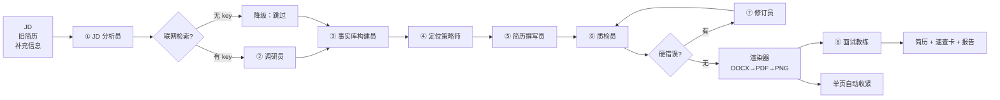
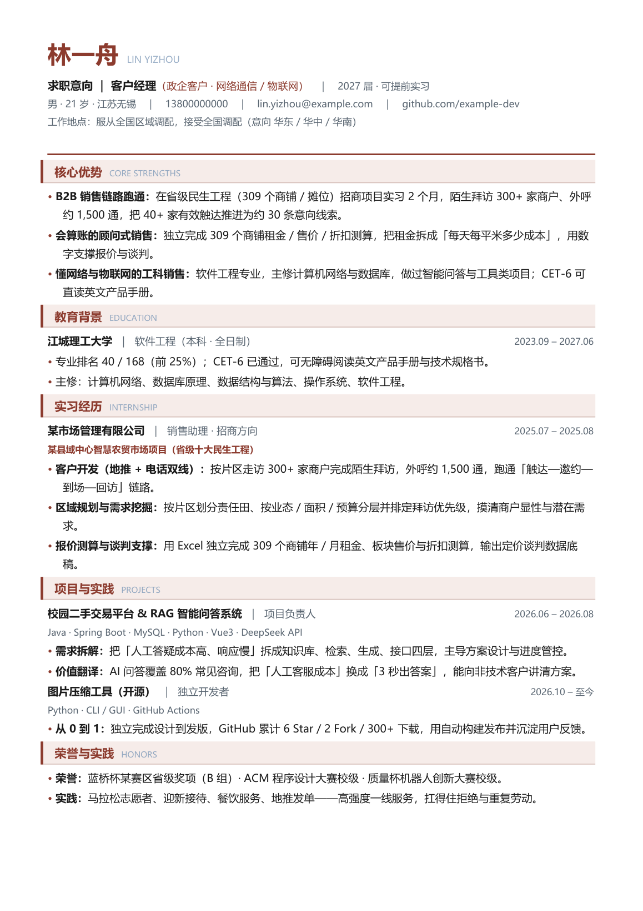

# resume-copilot

[](https://github.com/xiaomei004/resume-copilot/actions/workflows/ci.yml)
[](pyproject.toml)
[](LICENSE)

> 多 Agent 简历优化流水线：**JD + 旧简历 → 定制化简历（DOCX/PDF）+ 一页面试速查卡**

一个应届生投十个岗位，真正需要的不是"一份好简历"，而是**十份对着不同 JD 的简历**。手工做这件事的流程通常是：读 JD 猜筛人逻辑 → 翻旧简历找料 → 想主线 → 改文案 → 排一页 → 准备面试话术。每一步都不难，但一次要两三个小时，且容易写成"什么都沾一点"的通用版。

这个项目把上面这套动作拆成 7 个角色明确、权限受限的 Agent，串成一条可复现的流水线。它的设计目标不是"让 AI 编一份好看的简历"，而是**在禁止编造的前提下，把已有事实重新组织到最匹配的位置**。

## 它解决什么问题

| 手工做法 | 流水线做法 |
| --- | --- |
| 读 JD 靠感觉，抓不住隐含偏好（如"驻外补贴"= 要能异地） | JD 分析员输出硬门槛 / 加分项 / 隐含偏好 / 筛人逻辑 / 关键词 |
| 旧简历里明明有数字，改写时忘了或写错 | 事实库把每条经历拆成带来源与数字的原子事实，写作时只能引用 |
| 同一段经历投销售和投研发，讲法一样 | 定位策略师决定主线与取舍，按岗位族切换叙事 |
| 写完自我感觉良好，HR 一眼看出空话 | 机器闸门 + 质检员双检：数字溯源、关键词覆盖、空话清单 |
| 排完发现两页，删哪条都心疼 | 渲染器渲染→转 PDF→数页数→溢出自动收紧字号，最多 6 轮 |
| 面试前临时想自我介绍 | 面试教练基于**这份简历**产出口播稿、高频问题、群面/技术追问框架 |

## 工作流



每一步的输入输出都落盘在 `out/job-*/steps/`，可直接复盘"这句话是谁写的、依据哪条事实"。

跑出来的简历长这样（离线 mock 示例，单页 A4、无照片版式）：



## 快速开始

```bash
git clone https://github.com/example-dev/resume-copilot.git
cd resume-copilot

python -m venv .venv
# Windows: .venv\Scripts\activate    macOS/Linux: source .venv/bin/activate
pip install -e ".[pdf,web]"

cp .env.example .env      # 然后把你的 key 填进去
resume-copilot doctor     # 自检：key / 依赖 / LibreOffice / 检索
```

`.env` 只需要两个值就能跑（任何 OpenAI 兼容服务都行；没有 LibreOffice 时再加 `RESUME_CONVERT_CMD`）：

```dotenv
OPENAI_API_KEY=sk-你的key
OPENAI_BASE_URL=https://api.deepseek.com/v1
OPENAI_MODEL=deepseek-chat
```

### 先看效果（不花 token）

```bash
resume-copilot run --mock --dir examples/materials --role 客户经理 --out out
```

`--mock` 用 `examples/mock/fixtures.json` 里的预置输出走完整条流水线，产物与真实调用完全一致，用来确认环境、版式、产物链路没问题。

### 真实跑一次

```bash
# 方式一：目录自动分类（文件名含 jd / 简历 即可）
resume-copilot run --dir ./materials --role 客户经理 --photo ./photo.jpg

# 方式二：显式指定（JD 与旧简历都可以多份）
resume-copilot run \
  --jd jd.txt \
  --resume old_resume.pdf other_version.docx \
  --info notes.md \
  --role "后端开发" \
  --theme teal \
  --out out
```

产物：

```
out/job-20261029-185554/
├─ resume.docx          # 可继续手改
├─ resume.pdf           # 投递用
├─ resume.png           # 排版预览（看有没有孤字、溢出）
├─ interview_card.md    # 一页面试速查卡
├─ report.md            # 人读报告：定位、时间线、下一步
├─ manifest.json        # 机器读：metrics / usage / steps
├─ steps/               # 每个 Agent 的输入输出留档
└─ logs/trace.{jsonl,log}
```

### Web 界面

```bash
resume-copilot serve --port 8000
# 打开 http://127.0.0.1:8000
```

上传 JD 与旧简历 → 实时看流水线进度 → 在线预览排版 → 下载 PDF / 速查卡。

## 七个 Agent 与权限设计

| Agent | 职责 | 权限 | 为什么这样切 |
| --- | --- | --- | --- |
| JD 分析员 | 拆 JD：硬门槛 / 加分项 / 隐含偏好 / 关键词 / 筛人逻辑 | `read_jd` | 只读 JD，避免把简历内容反向"脑补"进岗位画像 |
| 调研员 | 带来源的调研简报（面试流程、加分信号） | `read_jd` `search_web` | **唯一能联网的角色** |
| 事实库构建员 | 把旧简历拆成带来源与数字的原子事实 | `read_resume` | 温度最低（0.1），只做抽取不做润色 |
| 定位策略师 | 决定讲哪个故事、删什么 | `read_jd` `read_facts` `read_research` | 只出策略，不动笔 |
| 简历撰写员 | 事实库 + 策略 → 结构化简历 JSON | `write_resume` | **无联网权限**，杜绝抄检索来的漂亮话 |
| 质检员 | 模拟会淘汰人的面试官，出问题清单 | `read_jd` `read_resume` `read_facts` | 只批评，不改稿 |
| 修订员 | 按意见定点修改 | `write_resume` | 与撰写员分离，避免"既当运动员又当裁判" |
| 面试教练 | 基于最终简历产出速查卡 | `read_resume` | 只读成品，不改简历 |

原则一句话：**能上网的不写简历，写简历的不上网。** 详见 [docs/agent-roles.md](docs/agent-roles.md)。

## 岗位变体：一份底座 + 三份叠加

`writer.md` 是**岗位无关的底座**（版式硬约束、JSON schema、事实边界、四类禁止补的内容）；
`writer.sales.md` / `writer.rnd.md` / `writer.support.md` 是**叠加的岗位变体**（模块顺序、该岗位到底在筛什么、
语言与配比、自检清单）。运行时按 `jd_profile.role_family` 自动附加，变体不存在就只用底座：

```
system = system_common.md + writer.md + writer.<role_family>.md
```

| 变体 | 模块顺序 | 主打 |
| --- | --- | --- |
| `sales` | 核心优势 → 教育 → 实习 → 项目 → 荣誉技能实践 | 客户数/线索/成交、算账能力、异地意愿 |
| `rnd` | 教育 → 技能 → 项目 → 实习 → 荣誉 | 技术栈匹配、工程约束、指标口径 |
| `support` | 教育 → 技能 → 实施/项目 → 实习 → 荣誉 | 交付、排障路径、驻场意愿、可复用产出 |

`coach` 同样有 `coach.sales.md`（群面/辩论）、`coach.rnd.md`（技术追问与手撕）、`coach.support.md`（客户现场处置），
所以同一个岗位族下，"怎么写"和"怎么答"用的是同一套假设。

同一个 `examples/materials_rnd` 材料，用 `--role 技术研发工程师` 跑会得到研发版（墨绿主题、项目优先）；
换成 `examples/materials` 与 `--role 客户经理` 就是销售版（砖红主题、实习优先）。两份示例都实测：**一页、0 硬错误**。

## 三道质量闸门

1. **事实闸门**：`verify.check_numbers()` 扫描简历里每个数字，必须能在事实库中找到出处；`check_fact_refs()` 拦截悬空引用。
2. **语言闸门**：空话清单（"沟通能力强""精通""全流程负责"）与超长要点（>96 字）直接报错/告警。
3. **版式闸门**：渲染后转 PDF 数页数，超过 1 页就自动收紧字号行距重排，最多 6 轮，并把每一轮的参数记进 `manifest.json`。

机器闸门只查"能不能被证伪"，语义上的夸大由质检员兜底，最终仍需人工过一遍——这是设计上的诚实边界，见 [docs/architecture.md](docs/architecture.md#已知边界)。

## 换岗位要改什么

| 想支持 | 改哪里 |
| --- | --- |
| 新的岗位族（如"售前 / 实施"） | `schemas.ROLE_KEYWORDS` 加关键词权重；`render/theme.ROLE_THEME` 选主题；`prompts/writer.md` 的模块顺序表补一行 |
| 新配色 | `render/theme.py` 里加一个 `Theme`，无需动渲染逻辑 |
| 换模型供应商 | `.env` 的 `OPENAI_BASE_URL` / `OPENAI_MODEL`，代码零改动 |
| 换岗位子系统 | 新增 `prompts/writer.<role_family>.md`（写法与裁剪规则），底座 `writer.md` 不动 |
| 加一个 Agent | `agents/roles.py` 声明 `AgentSpec` + 一个 prompt 文件，编排器自动识别 |
| 更严的校验 | `verify.py` 加函数，`check_resume()` 里挂上去，流水线无需改 |

## 目录结构

```
resume-copilot/
├─ src/resume_copilot/
│  ├─ agents/          # Agent 声明、权限、装配逻辑
│  ├─ prompts/         # 8 份 prompt（角色 / 约束 / 输出契约）
│  ├─ render/          # 主题、DOCX 渲染、PDF 转换、单页收紧
│  ├─ research/        # 检索抽象（Tavily / 无）
│  ├─ web/             # FastAPI + 单页前端
│  ├─ pipeline.py      # 编排器
│  ├─ verify.py        # 确定性闸门
│  ├─ schemas.py       # 数据结构与规范化
│  └─ ingest.py        # 输入摄取（txt/md/docx/pdf/图片）
├─ tests/              # 44 个用例，无需 pytest 也能跑
├─ examples/           # 示例材料 + mock 预置输出
└─ docs/               # 架构、Agent、Prompt 说明
```

## 踩过的坑（推荐先读）

[`docs/build-log.md`](docs/build-log.md) 记录了**开发过程本身**：需求怎么变成设计、开发期 Agent 怎么分工、
8 个角色的技术实现、四份 JSON 契约、降级矩阵、验证矩阵与 5 条技术决策记录（ADR）。

[`docs/lessons.md`](docs/lessons.md) 记录了 13 个真实发生过的故障与修法，包括：

- JD 的"隐含偏好"被写成候选人的事实（最危险的一类编造）
- 修订员用同义替换糊弄质检、越改越差 → 给每版打分并保留最优
- 关键词指标设计错误，反而在教模型说谎（覆盖率 19% → 50%）
- 微软雅黑 + `w:docGrid` 让 9.7pt 的字渲染出 18.8pt 的行距
- 用"文本抽取的行长度"判断换行，得到假阳性（要看 bbox 坐标）
- Windows GBK 控制台与子进程解码

## 开发

```bash
make test      # python -m unittest discover -s tests -t .
make mock      # 离线跑一遍演示
make serve     # 起 Web
make clean     # 清理 out/
```

不装 pytest 也能跑测试（全部基于标准库 `unittest`）；CI 里会额外跑 `ruff`。

## 已知边界（请先读）

- **它不会替你做出好简历，只会把已有事实放到正确位置。** 事实库空了，产出就空。
- **图片版 JD 需要配置 `RESUME_VISION_MODEL`**，否则请先把 JD 贴成文本。
- **页数校验需要 LibreOffice**；没有它仍会出 DOCX，但不会告诉你是否溢出。
- **联网检索是可选的**，不配 key 时整条链路自动降级，不会失败。
- **同一份材料只应投一次**：`--role` 给错会得到错位的叙事，投递前请自己读一遍 `report.md`。

## License

MIT © 2026 LIN YIZHOU
